# SIRGA — Documentación Técnica y Lógica de Negocio

> **Sistema Integral de Recaudación y Gestión de Afiliados**
> Plataforma SaaS para que Estudios Contables liquiden Declaraciones Juradas (DDJJ) mensuales de empresas ante Sindicatos, controlando aportes de ley (obligatorios) y cuotas de socio (voluntarias), mora y cobro coactivo.

---

## 1. Resumen del proyecto

| Dato | Valor |
|---|---|
| **Objetivo** | Recaudación gremial: DDJJ mensuales, aportes, rectificativas, saldos, mora y cobro coactivo |
| **Framework** | .NET 10 |
| **Frontend** | Blazor Web App (Interactive Server) + MudBlazor 9.4 |
| **ORM** | Entity Framework Core 10 (SQL Server) |
| **Arquitectura** | Clean Architecture (Domain, Application, Infrastructure, WebUI) |
| **Pagos** | MercadoPago (SDK), pago manual/transferencia, conciliación bancaria |
| **Documentos** | QuestPDF (boletas, actas, planes, constancias) y ClosedXML (Excel) |

Contexto normativo: aportes del Convenio Colectivo de Trabajo (Ley 24642 / CCT 130/75 Empleados de Comercio). Los porcentajes de aporte no son constantes: viven en la entidad `Union` (`LawContributionPercentage`, `UnionMemberPercentage`, ambos default 2%).

---

## 2. Arquitectura

### 2.1 Capas (Clean Architecture)

```
SIRGA.Domain          → Entidades + Enums. Modelo de datos "anémico" (sin lógica).
SIRGA.Application     → 16 servicios con la lógica de negocio + DTOs.
SIRGA.Infrastructure  → EF Core (persistencia), UnitOfWork + Repository, MercadoPago,
                        Email SMTP, Excel (ClosedXML), Migrations, DbInitializer.
SIRGA.WebUI           → Blazor Server + MudBlazor + controladores API + middlewares.
SIRGA.Tests           → xUnit (96 tests): cálculos financieros + reglas de dominio + capa de servicios.
```

> ✅ `SIRGA.slnx` ya referencia los 6 proyectos (Domain, Application, Infrastructure, WebUI, Tests y Migration): `dotnet build SIRGA.slnx` compila todo.

### 2.2 Registro de dependencias (`SIRGA.WebUI/Program.cs`)

- `AddDbContextFactory<SIRG_DbContext>` + `SIRG_DbContext` **transient** (creado desde la factory): el `UnitOfWork` (scoped) resuelve uno y lo comparte entre sus 24 repositorios, y los stores de Identity resuelven el suyo aparte. Antes era `scoped` (una sola instancia por circuito) y se reprodujo con un banco de pruebas que Identity + repositorio en paralelo lanzan `A second operation was started on this context instance`, porque el semáforo solo serializa el acceso del repositorio.
- `AddScoped<IUnitOfWork, UnitOfWork>` → UnitOfWork y todos los repositorios comparten el mismo `SIRG_DbContext` (transaccionalidad implícita por contexto compartido; sin `BeginTransaction`).
- `AddScoped(_ => new SemaphoreSlim(1, 1))` → serializa el acceso del repositorio dentro de cada circuito (en Blazor Server el scope es el circuito, no el request). **Pendiente**: reemplazarlo por un contexto por operación, que es el patrón recomendado para Blazor Server; son 251 usos de `unitOfWork` en 104 métodos.
- Servicios registrados como **Scoped**: `DeclarationService`, `EmployeeService`, `CompanyService`, `UnionService`, `SalaryScaleService`, `AuditService`, `InspectionService`, `AccountingStudioService`, `PaymentService`, `PdfReportService`, `BankReconciliationService`, `DebtNotificationService`, `BalanceService`, `AssociationService`, `EmployeeCategoryService`, `UnionSubscriptionService`, `IEmailService → EmailService`, `IPaymentService → MercadoPagoService`, `IReportService → ExcelReportService`.
- ASP.NET Identity: `AddIdentity<IdentityUser, IdentityRole>` con policy de contraseña laxa (min 6 chars, sin requisitos).

### 2.3 Patrones de persistencia

- **`Repository<T>`** genérico: `GetByIdAsync`, `GetAllAsync`, `FindAsync(predicado)`, `AddAsync`, `Update`, `Remove`.
- **`UnitOfWork`**: expone 24 repositorios tipados y `CompleteAsync()` → `SaveChangesAsync()`.
- **`SIRG_DbContext`**: extiende `IdentityDbContext` (tablas AspNet*). Índices únicos: `Employee.Dni` y `Company(Cuit + BranchName)`. Convención global: `decimal(18,2)`. Relaciones críticas con `OnDelete(Restrict)` para evitar ciclos.
- **`SIRG_DbContextFactory`** (design-time para migraciones): connection string hardcodeada `Server=localhost;Database=SIRGA_DB;Trusted_Connection=True`.

---

## 3. Modelo de datos

### 3.1 Entidades por módulo

#### Módulo Autoridad
- **`Union`** (parcial: `Union.cs` + `Union.Partial.cs`): `Name`, `JurisdictionProvince` (clave para sucursales), `JurisdictionCity`, `CctCode`, `IsActive`, `LawContributionPercentage` (default 2%), `UnionMemberPercentage` (default 2%), `AdminEmail` (multi-tenant por email).

#### Módulo Afiliación
- **`AccountingStudio`** — estudio contable: `Name`, `ResponsibleUsername`, `Email`, datos de contacto, `CityId`, `IsApproved` (default false), `IsActive`.
- **`Company`** — empresa **auto-referenciada** (`ParentCompanyId → Branches`): una cabecera con múltiples sucursales por CUIT. `Cuit`, `BusinessName`, `CityId`, `BranchName`, `AccountingStudioId`, `Status`, `IsActive` (default true). Default `PendingAuthorization`. `Status` rige el flujo de aprobación (estudio → sindicato); `IsActive` es la actividad derivada del legado en la migración (activa = tiene ≥1 asignación activa o presentó DDJJ 2026): **2.576 activas / 1.931 inactivas** de 4.507.
- **`Employee`** — `Dni` (único), `FullName`, `HireDate`, `TerminationDate`, `Status`, `BiometricData` (byte[] huella).
- **`SindicataryAssignment`** — **entidad puente M:N Empleado↔Empresa↔Sindicato**: `EmployeeId`, `CompanyId`, `UnionId`, `IsVoluntaryMember` (define cuota de socio), `CategoryCode`, `IsActive` (default true), `TerminationDate`. En la migración del legado, `IsVoluntaryMember` se deriva de `ddjj.item2` (bool): una asignación es socia si alguna DDJJ suya tiene `item2 = true` (12.896 de 36.011 migradas). `IsActive`/`TerminationDate` provienen de `socemp.SOCEMP_ESTADO`/`SOCEMP_FECHABAJA` (9.593 activas / 26.418 de baja).
- **`EmployeeCategory`** — categorías por sindicato: `Code`, `Name`, `UnionId`, `IsActive`.
- **`SalaryScale`** — escala salarial por (sindicato, período, categoría): `Period`, `EmployeeCategoryId`, `BasicAmount`, `AntiguedadPercentage`, `AgreementNR1`, `AgreementNR2`, `IsActive`.

#### Módulo Transaccional (DDJJ)
- **`DeclarationRegistry`** — DDJJ: `Period` (YYYY-MM), `CompanyId`, `UnionId`, `Status` (Draft/Submitted/Approved/Rejected/Paid), `TotalAmount`, `IsRectification`, `PreviousAmount`, `BalanceAmount`, `PresencialBarCode`, `PresencialReference`, `MercadoPagoPaymentId`, `PaymentDate`.
- **`DeclarationDetail`** — por empleado: `RegistryId`, `AssignmentId`, `BaseSalary`, `LawContribution`, `MemberContribution`, `TotalWithheld`.

#### Módulo Pagos y Saldos
- **`PaymentTransaction`**: `DeclarationId`, `Amount`, `PaymentDate`, `ExternalReference`, `PaymentMethod`, `Notes`.
- **`CompanyBalance`**: `CreditAmount` (saldo a favor acumulado), `LastUpdate`.
- **`BalanceHistory`**: movimientos de crédito (positivo = crédito ganado, negativo = usado), `Concept`, `DeclarationId`.
- **`InterestRate`**: `EffectiveDate`, `MonthlyRate`, `Description` (tasas ARCA).

#### Módulo Cobranza / Fiscalización
- **`InspectionAct`**: acta de oficio por deuda. `ActNumber` (ACT-YYYY-xxxx), `CompanyId`, `UnionId`, `PeriodRange`, `EstimatedDebt`, `InterestAmount`, `TotalAmount` (**propiedad calculada** = deuda + interés), `Status` (Pending/Notified/InCovenant/Paid/Cancelled/Legal).
- **`InspectionActPeriod`**: período del acta con `BaseAmount`, `CalculatedInterest`, `WasAlreadyDeclared`.
- **`Inspector`** / **`InspectionVisit`**: visitas (máx. 3) por acta, con `VisitNumber`, `Status`, `DocumentNumber`, `DebtorSigned`.
- **`PrejudicialNotice`** / **`NoticeAttachment`**: aviso prejudicial (vencimiento a 10 días), archivos adjuntos (demanda/oficio/prueba).
- **`PaymentPlan`** / **`PaymentPlanInstallment`**: convenio de pago. Cuota 0 = anticipo; cuotas 1..N. `Status` (Active/Completed/Defaulted/Cancelled).

#### Módulo SaaS
- **`UnionSubscription`**: `UnionId`, `MonthlyFee`, `NextBillingDate`, `IsServiceActive`.
- **`UnionSubscriptionPayment`**: pagos del abono (renueva período +1 mes).
- **`UnionSubscriptionRequest`**: solicitud de alta de sindicato como cliente (formulario público). `Status` (Pending/Approved/Rejected).

#### Otros
- **`AuditLog`**: auditoría genérica (`EntityName`, `EntityId`, `Action`, `PreviousValues`/`NewValues` en JSON, `UserId`, `UserEmail`, `IPAddress`).
- **`Province` / `City`**: geografía (una ciudad pertenece a una provincia).

### 3.2 Enums

| Enum | Valores |
|---|---|
| `CompanyStatus` | PendingAuthorization=0, Active=1, Suspended=2, ChangeStudioRequested=3, Inactive=4, Rejected=5 |
| `DeclarationStatus` | Draft=1, Submitted=2, Approved=3, Rejected=4, Paid=5 |
| `EmployeeStatus` | Active=1, LeaveOfAbsence=2, MaternityLeave=3, AccidentLeave=4, Inactive=5 |
| `RequestStatus` | Pending=0, Approved=1, Rejected=2 |
| `InspectionActStatus` | Pending, Notified, InCovenant, Paid, Cancelled, Legal |
| `PaymentPlanStatus` | Active, Completed, Defaulted, Cancelled |
| `SubscriptionRequestStatus` | Pending, Approved, Rejected |

### 3.3 Diagrama de relaciones (ER)

```mermaid
erDiagram
    UNION ||--o{ SINDICATARYASSIGNMENT : "asigna"
    UNION ||--o{ DECLARATIONREGISTRY : "recibe"
    UNION ||--o{ EMPLOYEECATEGORY : "tiene"
    UNION ||--o{ SALARYSCALE : "define"
    UNION ||--o{ INSPECTIONACT : "fiscaliza"
    UNION ||--o{ UNIONSUBSCRIPTION : "abona"
    UNION ||--o{ COMPANYASSOCIATIONREQUEST : "objetivo"

    EMPLOYEE ||--o{ SINDICATARYASSIGNMENT : "empleado"
    COMPANY ||--o{ SINDICATARYASSIGNMENT : "sucursal"
    COMPANY ||--o{ DECLARATIONREGISTRY : "presenta"
    COMPANY ||--o{ COMPANYBALANCE : "saldo"
    COMPANY ||--o{ INSPECTIONACT : "deudora"
    COMPANY ||--o{ COMPANY : "parent/branches"
    COMPANY o|--o| ACCOUNTINGSTUDIO : "gestiona"
    COMPANY o|--o{ CITY : "sede"
    ACCOUNTINGSTUDIO o|--o{ COMPANYASSOCIATIONREQUEST : "solicita"

    DECLARATIONREGISTRY ||--o{ DECLARATIONDETAIL : "detalle"
    DECLARATIONREGISTRY ||--o{ PAYMENTTRANSACTION : "paga"
    SINDICATARYASSIGNMENT ||--o{ DECLARATIONDETAIL : "origen"

    EMPLOYEECATEGORY ||--o{ SALARYSCALE : "escala"

    INSPECTIONACT ||--o{ INSPECTIONACTPERIOD : "periodos"
    INSPECTIONACT ||--o{ INSPECTIONVISIT : "visitas"
    INSPECTIONACT ||--o{ PREJUDICIALNOTICE : "aviso"
    INSPECTIONACT ||--o{ PAYMENTPLAN : "convenio"
    INSPECTOR ||--o{ INSPECTIONVISIT : "realiza"
    PREJUDICIALNOTICE ||--o{ NOTICEATTACHMENT : "adjuntos"
    PAYMENTPLAN ||--o{ PAYMENTPLANINSTALLMENT : "cuotas"
    UNIONSUBSCRIPTION ||--o{ UNIONSUBSCRIPTIONPAYMENT : "abonos"

    PROVINCE ||--o{ CITY : "contiene"
```



---

## 4. Lógica de negocio por flujo

### 4.1 Onboarding SaaS de sindicatos (`UnionSubscriptionService`)

1. Un sindicato se da de alta desde `/subscribe` → se crea `UnionSubscriptionRequest` en `Pending`.
2. El Admin aprueba desde `/admin/subscription-requests` → flujo compuesto:
   - Crea la entidad `Union` (con `CctCode = "PENDIENTE"` para que el admin lo complete, jurisdicción tomada de la solicitud, `AdminEmail`).
   - Crea el `IdentityUser` con el email de contacto (si no existe) y **password fija `12345`** (⚠️ MVP).
   - Asegura el rol `"Sindicato"` y lo asigna.
   - Crea `UnionSubscription` con `MonthlyFee = 50000`, `NextBillingDate = +1 mes`, servicio activo.
3. **Renovación**: `RecordPaymentAsync` registra el pago del abono y corre `NextBillingDate` +1 mes.
4. **Morosidad** (dashboard admin): un sindicato es "moroso" si `!IsServiceActive` o `NextBillingDate < now`.
5. **Bloqueo de acceso**: `SubscriptionStatusMiddleware` redirige a `/subscription-expired` si el `UnionId` del usuario tiene suscripción inactiva o vencida (excepto roles `Admin`/`Administrador` y rutas `/api/`, `/logout`).

**Dashboard admin** (`GetAdminDashboardStatsAsync`): sindicatos activos/morosos, solicitudes pendientes, estudios, empleados, métricas del mes e ingresos mensuales.

### 4.2 Configuración del sindicato

- `UnionService`: CRUD de sindicatos (define la jurisdicción que usa el algoritmo de asignación) y consulta de provincias/ciudades.
- `EmployeeCategoryService`: categorías laborales por sindicato. **No se puede eliminar una categoría con escalas asociadas** (validación de integridad).
- `SalaryScaleService`: escalas paritarias por (período, categoría, sindicato). La DDJJ **se rechaza si no existe escala para el período**.
- `InterestRate`: tasas mensuales vigentes (default 3% si no hay ninguna).

### 4.3 Registro de estudios contables y empresas (workflow de aprobación)

1. Un estudio se registra en `/register` (rol `EstudioContable`) → `AccountingStudio.IsApproved = false`. No puede operar hasta que el sindicato lo apruebe (`/admin/studios-approval`); en el login se lo redirige a `/studio-pending`.
2. `CompanyService.RegisterCompanyAsync` crea la empresa con `Status = PendingAuthorization` y `BranchName = "Sede Central"`.
3. `AssociationService`: el estudio solicita la vinculación de una empresa a un sindicato (`CompanyAssociationRequest` en `Pending`).
4. Al aprobar la solicitud: asigna `company.AccountingStudioId` y **activa la empresa** (`Active`). Al rechazar (si estaba pendiente) pasa a `Rejected`.
5. Las sucursales adicionales se crean como `Company` con `ParentCompanyId` → jerarquía.

### 4.4 Resolución de jurisdicción y asignación de empleados (`EmployeeService`)

Al crear un empleado para una sucursal (con `CityId`):

1. Resuelve la jerarquía geográfica: Ciudad → Provincia.
2. **Algoritmo de asignación sindical** (2 pasos):
   - Primero: sindicato con `JurisdictionProvince` **y** `JurisdictionCity` coincidentes (filial local).
   - Fallback: sindicato provincial general (`JurisdictionCity` null) para esa provincia.
   - Si no hay → error de configuración.
3. Si el DNI ya existe, **reutiliza** el `Employee`; si no, lo crea (status `Active`).
4. Crea la `SindicataryAssignment` (empleado+sucursal+sindicato, `IsVoluntaryMember`).

**Transferencia** (`TransferEmployeeAsync`): revalida la jurisdicción de la sucursal destino y actualiza `CompanyId` + `UnionId` de la asignación → cambia el sindicato que retiene los aportes.

### 4.5 DDJJ: cálculo de aportes, rectificativas, intereses y boleta (`DeclarationService`)

Flujo de `CreateDeclarationAsync` (`SIRGA.Application/Services/DeclarationService.cs:22`):

1. **Validaciones**: existe la sucursal, existe el sindicato, y hay **escala salarial cargada para el período** (formato `YYYY-MM`).
2. **Detección de rectificativa**: si existe una DDJJ previa del mismo (empresa, período) en estado `Paid`, `IsRectification = true` y guarda `PreviousAmount`.
3. **Cálculo por empleado** (para cada `SindicataryAssignment` de la sucursal que tenga categoría en la escala):
   - `antigüedad = años desde HireDate al período` (mín. 0).
   - `antiguedadAmount = básico × (AntiguedadPercentage/100) × años`.
   - `remunerativoTotal = básico + antiguedadAmount`.
   - `aporteLey = remunerativoTotal × (union.LawContributionPercentage/100)` ← **% dinámico del sindicato**.
   - `cuotaSocio = remunerativoTotal × (union.UnionMemberPercentage/100)` **solo si `IsVoluntaryMember`**.
   - `TotalWithheld = aporteLey + cuotaSocio` (el pago al sindicato).
   - Los acuerdos no remunerativos (`AgreementNR1 + NR2`) suman al total.
4. **Rectificativa**: `BalanceAmount = totalNuevo − PreviousAmount`. Si es negativo (pagó de más) → genera **crédito a favor** (ver 4.7).
5. **Uso de crédito** (solo DDJJ nuevas): descuenta el crédito disponible del `BalanceAmount` (la boleta sale por el saldo).
6. **Intereses por mora**: vencimiento sugerido = **día 15 del mes siguiente**. Si `now > dueDate`, `interés = saldo × tasaVigente × mesesMora` (mín. 1 mes) y se suma al saldo.
7. **Código de barras** ficticio: `001 + CUIT + período + monto×100` en 10 dígitos.
8. **Auditoría** (`LogActionAsync`): acción "Presentación" o "Rectificativa".
9. **Post-guardado**: rectificativa negativa → `ProcessDeclarationBalanceAsync` (genera crédito); DDJJ nueva → `UseCreditAsync` (descuenta crédito oficial).
10. **Notificación**: genera la boleta PDF (QR + código Code128 + desglose de aportes + intereses) y la envía al email del estudio contable. El fallo de email **no rompe** la creación (try/catch).

**Aprobación / rechazo**: cambian `Status` a `Approved`/`Rejected` (el parámetro de observación se ignora en la implementación actual).

### 4.6 Pagos

- **MercadoPago** (`MercadoPagoService`):
  - `CreatePaymentPreferenceAsync(declarationId)`: crea la preferencia (item = DDJJ, payer = empresa con CUIT, `ExternalReference = "DDJJ_{id}_CLI_{companyId}"`), persiste la referencia y devuelve `PreferenceId`/`InitPoint`.
  - `ProcessWebhookAsync(topic, id)`: solo `topic == "payment"`; si el pago está `approved`, parsea el `DeclarationId` del `ExternalReference` y marca la DDJJ como `Paid` (guarda `MercadoPagoPaymentId` y `PaymentDate`). ⚠️ Sin verificación de firma.
- **Pago manual / transferencia** (`PaymentService.ConfirmPaymentAsync`): valida la DDJJ, es idempotente (si ya está `Paid` no duplica), crea `PaymentTransaction` y marca `Paid`.
- **Conciliación bancaria** (`BankReconciliationService`): importa Excel bancario (columnas A=Fecha, B=Referencia, C=Importe, D=CUIT/ID) y empareja contra DDJJ no pagadas con tolerancia `|total − importe| < 1`. ⚠️ Los emparejamientos **no se persisten** (solo se devuelven).

### 4.7 Balances y créditos (`BalanceService`)

Modelo de cuenta corriente simple: `CompanyBalance.CreditAmount` por empresa.

- **Rectificativa con saldo negativo** (pagó de más) → `ProcessDeclarationBalanceAsync` genera crédito por `|BalanceAmount|` y registra `BalanceHistory` ("Crédito por Rectificativa Periodo X").
- **Uso de crédito** (`UseCreditAsync`): conservador, `Math.Min(saldo, montoNecesario)`, no deja saldo negativo, registra movimiento negativo ("Uso de saldo en DDJJ ID X").
- `GetFullStatementAsync` → estado de cuenta con historial.

### 4.8 Mora: mapa de deudores y notificación

`AuditService.GetStatsAsync` (dashboard de auditoría):

- Recaudación mensual (últimos 6 períodos) por `Period`.
- **Mapa de deudores**: período de referencia = mes anterior. Una empresa es **deudora** si **no presentó DDJJ** en ese período pero **tiene empleados asignados**.
  - Deuda estimada (mock): `empleados × 5000`.
  - Intereses: meses de mora desde su última DDJJ × tasa vigente (default 3%).

`DebtNotificationService.NotifyAllDebtorsAsync`: envía email HTML a cada deudor (a `Company.ContactEmail` o fallback `AccountingStudio.Email`) con la última presentación, deuda capital, intereses y total a regularizar.

### 4.9 Cobro coactivo (`InspectionService`)

**Acta de oficio** (`CreateActOficioAsync`):
- `ActNumber = "ACT-{año}-{aleatorio}"`, estado `Pending`, `PeriodRange` entre min/max de períodos.
- Por período: si existe DDJJ usa su `TotalAmount`; si no, base estimada fija **$50.000**.
- Intereses: vencimiento día 15 del mes siguiente al período; `mesesMora = máx(1, meses desde vencimiento)`; `interés = base × tasaVigente × mesesMora`.
- Audita la creación.

**Visitas de inspección**: `RegisterVisitAsync` asigna el siguiente `VisitNumber` (1, 2 o 3). **Máx. 3 visitas** (la 4ª lanza excepción). En la 3ª visita hay comentado un disparo automático de aviso prejudicial.

**Aviso prejudicial** (`CreatePrejudicialNoticeAsync`): `NoticeNumber = "PRE-{año}-{aleatorio}"`, vencimiento a **10 días**, `WasNotified = true`, y cambia el acta a estado `Legal`.

**Judicialización** (`PromoteToJudicialAsync`): marca el aviso `IsJudicial = true`.

**Plan de pago** (`CreatePaymentPlanAsync`):
- Solo sobre actas `Pending`.
- `TotalDebt = act.TotalAmount`; `DownPayment = TotalDebt × (%/100)`.
- Cuota 0 = anticipo (vencimiento a 7 días).
- **Interés directo** (no amortizable): `interésTotal = saldo × (tasaMensual/100) × nºCuotas`; cuota = `(saldo + interés)/nºCuotas`.
- Al crear el plan el acta pasa a `Paid`. (⚠️ usa `Paid` aunque en realidad se refinanció.)

**PDFs** (`PdfReportService`): acta de inspección (intimación 48 hs), convenio (cláusula de caducidad por 2 cuotas consecutivas/3 alternadas), boleta SIRGA (QR + Code128 + desglose + mora) y constancia de visita (advertencia roja en la 3ª).

### 4.10 Auditoría (`AuditService`)

`LogActionAsync(entityName, entityId, action, oldValues, newValues, userId, userEmail, ipAddress)` serializa los valores a JSON y guarda `AuditLog`. Se usa en: alta de actas, planes de pago, presentación/rectificativa de DDJJ y otras acciones clave.

---

## 5. Roles, permisos y portales

### 5.1 Roles existentes

`Admin` / `Administrador`, `Sindicato`, `Auditor`, `EstudioContable` (y `Empresa` mencionado en el middleware de suscripción).

### 5.2 Menú por portal (`NavMenu.razor`)

| Portal | Secciones |
|---|---|
| **EstudioContable** (aprobado) | Portal Estudio `/estudio/dashboard`, Empresas, Empleados, Nueva DDJJ `/declarations/new`, Historial |
| **EstudioContable** (no aprobado) | Solo "Solicitud Pendiente" `/studio-pending` |
| **Sindicato / Auditor** | Panel Sindicato, Panel Fiscalización `/audit/dashboard`, Revisión de DDJJ `/audit/review`, Aprobación Estudios, Estudios y Empresas `/union/studios`, Solicitudes de Vinculación, Reportes de Recaudación, Administración Sindicato (empresas/empleados), Recaudación (nueva DDJJ, historial, pagos) |
| **Admin / Administrador** | Dashboard Global `/admin/dashboard`, Solicitudes SaaS `/admin/subscription-requests`, Gestión de Abonos `/admin/subscriptions`, Configuración Global (sindicatos `/unions`, escalas `/admin/salary-scales`, tasas `/admin/interest-rates`, conciliación pagos `/admin/payments`) |

### 5.3 Rutas principales del frontend

**Públicas**: `/`, `/login`, `/register`, `/logout`, `/subscribe`, `/subscription-expired`, `/studio-pending`.
**Estudio**: `/estudio/dashboard`, `/companies`, `/employees`, `/declarations/new`, `/declarations/history`, `/empresa/{id}/historial`, `/empresa/{id}/empleados`, `/company/{id}/balance`.
**Sindicato/Auditor**: `/sindicato/dashboard`, `/audit/dashboard`, `/audit/review`, `/admin/studios-approval`, `/union/studios`, `/association-requests`, `/reports/collections`, `/union/inspection`, `/inspectors`, `/inspection-stats`, `/legal-notices`.
**Admin**: `/admin/dashboard`, `/admin/subscription-requests`, `/admin/subscriptions`, `/unions`, `/admin/salary-scales`, `/admin/interest-rates`, `/admin/payments`.

> ⚠️ Las rutas `/profile` y `/settings` aparecen en el menú del AppBar pero **no tienen página** implementada.

---

## 6. Catálogo API

**Nota transversal**: la mayoría de los endpoints son anónimos, pero **6 exigen rol**: `POST /api/declarations` (crear DDJJ) y `/approve`, `/reject` (`DeclarationsController`), y `POST /api/employees/membership/resign`, `/resolve` y `GET /api/employees/membership/requests` (`EmployeesController`).
⚠️ Como los componentes Blazor llamaban a esos endpoints con un `HttpClient` propio que **no lleva la cookie de sesión**, respondían 401 y la operación no se guardaba. Por eso esas pantallas ahora llaman a los servicios de aplicación directamente. Si se agrega `[Authorize]` a otro endpoint que consuma la UI, hay que hacer lo mismo o reenviar la cookie.

Además, `GET /api/declarations` y `GET /api/employees` están **paginados** (parámetro `pageSize`, por defecto 200 y tope 500): antes devolvían las 248.151 DDJJ (115,68 MB, 40,5 s) y los 27.934 empleados (4,76 MB) completos.

| Controlador | Endpoint | Descripción |
|---|---|---|
| `AccountController` | POST `/account/login`, `/account/register`, GET/POST `/account/logout` | Autenticación MVC. Bloquea estudios no aprobados; register crea el estudio (pending) si rol = EstudioContable |
| `AuditController` | GET `/api/audit/dashboard?unionId=`; POST `/api/audit/notify-debtors` | Estadísticas de recaudación/mora; aviso masivo de deuda |
| `BalanceController` | GET `/api/balance/{companyId}` | Estado de cuenta con saldo/deuda/intereses |
| `CompaniesController` | GET `/api/companies?username=`; GET `/{id}`; POST `?studioId=&unionId=`; PUT `/{id}` | CRUD empresas. POST con estudio+sindicato → PendingAuthorization + solicitud de vinculación |
| `DeclarationsController` | POST `/api/declarations`; GET ``, `/by-union/{id}`, `/{id}`, `/history/{companyId}`, `/{id}/details`; POST `/approve`, `/reject` | DDJJ: crear, consultar, aprobar, rechazar |
| `EmployeesController` | GET ``, `/by-company/{id}`, `/by-assignment/{companyId}/{unionId}`; POST; PATCH `/transfer/{id}?fromCompanyId=&toCompanyId=` | Empleados y asignaciones |
| `InterestRateController` | GET/POST `/api/interestrate`; DELETE `/{id}` | Tasas ARCA |
| `PaymentController` | POST `/api/payment/import-excel`, `/salaries-excel`, `/bulk-confirm`, `/manual`, `/webhook/mercadopago`; GET `/api/payment` | Conciliación bancaria, pagos manuales, webhook MP |
| `PaymentsController` | POST `/api/payments/preferences/{declarationId}`; POST `/api/payments/webhook?topic=&id=` | MercadoPago: preferencia y webhook IPN |
| `ReportController` | GET `/api/report/inspection/{id}`, `/payment-plan/{id}`, `/boleta/{id}`, `/visit/{id}`, `/padron?companyId=&city=`, `/debtors-excel`, `/collections-excel` | PDFs y Excels de reportes |
| `ReportsController` | GET `/api/reports/employees-excel?companyId=` | Excel padrón de afiliados (⚠️ duplicado con ReportController) |
| `SalaryScalesController` | GET `/api/salaryscales/{year}/{month}`, `/api/salaryscales`; POST; PUT `/{id}`; DELETE `/{id}` | Escalas paritarias |
| `UnionsController` | GET `/api/unions`; POST `/api/unions/create-user` | Sindicatos; alta de usuario sindicato (⚠️ password fija `12345` expuesta) |

---

## 7. Configuración y puesta en marcha

### 7.1 Configuración (`appsettings.json`)

```json
"ConnectionStrings": {
  "DefaultConnection": "Server=localhost;Database=SIRGA_DB;Trusted_Connection=True;TrustServerCertificate=True;"
},
"ApiBaseUrl": "http://localhost:5122/"
```

- Credenciales de MercadoPago y SMTP se esperan de user-secrets/otras fuentes (no están en appsettings).
- `Email`: SMTP default `localhost:25`, from `no-reply@sirga.com`.

### 7.2 Perfiles de ejecución

| Perfil | URL |
|---|---|
| `http` | `http://localhost:5122` |
| `https` | `https://localhost:7258` (+ `http://localhost:5122`) |

### 7.3 Arranque y seeds

Al iniciar, `Program.cs` ejecuta `DbInitializer.SeedLocationsAsync` (siembra 3 provincias / 6 ciudades si están vacías). ⚠️ `SeedIdentityAsync` está **vacío** (no crea roles ni usuarios; los roles se crean en runtime).

### 7.4 Usuarios de prueba (script `tools/reset-passwords.cs`)

Resetear contraseñas a `12345` y crear/garantizar roles:

```powershell
dotnet run .\tools\reset-passwords.cs            # todos -> 12345
dotnet run .\tools\reset-passwords.cs "MiPass"   # personalizar
dotnet run .\tools\reset-passwords.cs "MiPass" "admin@sirga.com"  # solo un email
```

| Email | Rol | Password |
|---|---|---|
| `admin@sirga.com` | Admin | `12345` |
| `auditor@sirga.com` | Auditor | `12345` |
| `sindicato@sirga.com` | Sindicato | `12345` |
| `estudio@test.com`, `estudio@prueba.com`, `estudio2@prueba.com`, `estudio3@prueba.com` | EstudioContable | `12345` |

> Los **844 estudios contables migrados** del legado tienen usuario Identity generado automáticamente con su email y password `12345` (idempotente, omitiendo emails ya existentes). El registro de cuentas queda en `tools/estudios_usuarios.csv`.

### 7.4.1 Generación de usuarios de estudios migrados (`tools/create-studio-users.cs`)

Crea un `IdentityUser` (rol `EstudioContable`) por cada `AccountingStudio` con email, usando ese email como nombre de usuario y una password fija (default `12345`):

```powershell
dotnet run .\tools\create-studio-users.cs                    # password 12345, escribe tools/estudios_usuarios.csv
dotnet run .\tools\create-studio-users.cs "MiPass"           # password personalizada
dotnet run .\tools\create-studio-users.cs "MiPass" "out.csv" # ruta del CSV
```

- **Idempotente**: omite emails que ya son usuarios (re-ejecutable sin duplicar).
- Solo procesa estudios **con email**; los usuarios existentes no se tocan.
- Escribe el listado completo de cuentas (Email;Password;Nombre;Teléfono) en `tools/estudios_usuarios.csv`.
- ⚠️ La política de contraseñas exige mínimo 5 caracteres (`Program.cs` `RequiredLength = 5`).

### 7.5 Base de datos

- SQL Server local, DB `SIRGA_DB` (36 tablas). Aplicar migraciones: `dotnet ef database update` desde `SIRGA.Infrastructure` (factory design-time con connection string propia).
- **Datos migrados del legado `Sindicato`** (corrida `all` de `SIRGA.Migration`, 14/08/2026): 25 provincias, 2.596 ciudades, 1 sindicato SEC, 21 categorías, 1.339 escalas, **4.507 empresas**, **27.934 empleados**, **36.011 asignaciones** (12.896 socias), 844 estudios, **248.151 DDJJ** y **1.269.977 detalles**, con **montos cuadrados 7.514.730.620,20**. Detalles en `MIGRACION_SIRGA.md`.

---

## 8. Pruebas

```powershell
dotnet test .\SIRGA.Tests\SIRGA.Tests.csproj
```

- **52 tests** (xUnit), pasan en ~300 ms.
- `DomainRulesTests`: reglas de dominio (actas, planes de pago, estados, defaults).
- `FinancialCalculationTests`: interés simple, cuota francesa, aportes 2%/6%, mora, ajustes de acta.

---

## 9. Estado del proyecto: completo / incompleto / faltante

### Funcional (comprobado/implementado)
- Login/registro con Identity + roles dinámicos.
- Onboarding SaaS de sindicatos (solicitud → aprobación → alta) y gestión de abonos.
- Alta de estudios contables (con aprobación), empresas y sucursales (con workflow de aprobación por vinculación).
- Alta de empleados con resolución automática de jurisdicción y transferencias.
- Presentación de DDJJ con cálculo de aportes, rectificativas, intereses de mora, boleta PDF y notificación por email.
- Aprobación/rechazo de DDJJ, pagos manuales, webhook MP (básico), conciliación bancaria (parcial).
- Balances/créditos por rectificativas.
- Mapa de deudores, avisos por email, actas de oficio, visitas (3), avisos prejudiciales, planes de pago.
- Reportes PDF (QuestPDF) y Excel (ClosedXML).

### Incompleto / parcial
- **Conciliación bancaria**: los emparejamientos no se persisten ni marcan la DDJJ como pagada.
- **Webhook MercadoPago**: solo `topic=payment`, sin verificación de firma ni reintentos; dos endpoints superpuestos (`api/payment/webhook/mercadopago` y `api/payments/webhook`).
- **Pago online**: las boletas/DDJJ quedan `Approved` pero la integración end-to-end con checkout MP no está completa de forma verificable sin credenciales.
- **Perfiles `/profile` y `/settings`**: en el menú pero sin páginas.
- **Seed de Identity vacío**: no hay superusuario por defecto garantizado.
- **Importación de nómina Excel** (`ProcessExcelDeclarationAsync`): solo devuelve empleados con sueldo; no crea la DDJJ completa.
- `BankReconciliationService` devuelve resultados sin persistencia.

### Faltante (módulos sin implementar)
- Biometría/lectura de huella de empleados (solo campo `byte[]` en el modelo).
- Seguro de Sepelio como concepto independiente (aparece en DTOs/PDF como `totalSepelio` calculado como resto, pero no hay columna propia).
- Rectificativas con observaciones persistidas (el parámetro `observation` se ignora).
- Portal/página de Empresa como rol autónomo.

---

## 10. Deuda técnica y riesgos

| # | Riesgo | Detalle |
|---|---|---|
| 1 | **API sin autorización** | Ningún controlador tiene `[Authorize]`; cualquiera puede llamar a los endpoints vía HTTP directo |
| 2 | **Password fija `12345`** | `UnionsController.create-user` y `UnionSubscriptionService` crean usuarios sindicato con clave hardcodeada y la exponen en la respuesta |
| 3 | **Webhook MP sin firma** | No valida la autenticidad de la notificación; asume formato exacto de `ExternalReference` |
| 4 | **Contratos desalineados** | `IPaymentService` declara `CreatePaymentPreferenceAsync`/`ProcessWebhookAsync`, pero la clase `PaymentService` no los implementa |
| 5 | **`InspectionAct.TotalAmount`** | Propiedad calculada sin `[NotMapped]` → riesgo de que EF intente mapearla |
| 6 | **Controladores duplicados** | `Payment`/`Payments`, `Report`/`Reports` con responsabilidades solapadas |
| 7 | **Migraciones caóticas** | Serie de syncs (V3/V4/V5, Consolidate) que indican desincronización modelo↔migraciones durante el desarrollo |
| 8 | **`SeedIdentityAsync` vacío** | La "inicialización" no crea roles ni usuarios; los roles dependen del runtime |
| 9 | **Warnings de nullability** | En `EmployeeService`, `DeclarationService`, `AuditService`, `PdfReportService` (CS8601/8602/8604) |
| 10 | **Encoding en Excel** | Mojibake en encabezados ("último", "Recaudación") en `ExcelReportService`; merge de 7 columnas con 6 headers en padrón |
| 11 | **Interés directo en planes** | Convenio con interés no amortizable y acta marcada `Paid` al refinanciar |
| 12 | **Deuda estimada mock** | Base fija $5.000/empleado y $50.000 por período sin escala: cifras no reales |
| 13 | **SMTP localhost** | Emails fallarán en dev; el envío está en try/catch (no rompe el flujo) |

---

## 11. Roadmap sugerido (fases)

**Fase 1 — Endurecer seguridad (prioridad alta)**
- Agregar `[Authorize]` y políticas por rol a todos los controladores.
- Quitar la password fija `12345`: generar clave aleatoria + flujo de primer acceso / reset por email.
- Verificar firma del webhook de MercadoPago y unificar los dos endpoints.

**Fase 2 — Completar el ciclo de cobro**
- Persistir la conciliación bancaria y marcar DDJJ como `Paid`.
- Completar integración de checkout MercadoPago con credenciales reales y testear end-to-end.
- Agregar observaciones reales a aprobación/rechazo y persistirlas.

**Fase 3 — Cálculo real de deuda**
- Reemplazar las bases mock (`empleados × 5000`, `$50.000`) por escalas salariales reales en actas.
- Modelar Seguro de Sepelio como columna/concepto propio (hoy es "resto" en DTOs).

**Fase 4 — Completar módulos faltantes**
- Páginas `/profile` y `/settings`.
- Seed de Identity con superusuario/roles por defecto.
- Portal de Empresa autónomo.
- Importación de nómina que genere la DDJJ completa.

**Fase 5 — Calidad**
- Eliminar warnings de nullability, duplicar controladores y limpiar el historial de migraciones.
- Corregir encoding en Excel y el merge de columnas del padrón.
- Ampliar cobertura de tests a los servicios (Application) con mocks de `IUnitOfWork`.

---

_Nota: Este documento refleja el estado del repositorio al momento de su generación. El proyecto corre en una notebook DIEGOHP (Ryzen 7, 16GB) — se priorizaron consultas async/await y evitar leaks de memoria._

---

## 12. Sesión de optimización (sep 2026): qué se midió y qué queda

Todo se midió contra la base real (`SIRGA_DB`: 248.151 DDJJ, 1.269.977 detalles, 27.934 empleados, 4.507 empresas).

| Cambio | Antes | Después |
|---|---|---|
| `GET /api/audit/dashboard` | 103,7 s y 119 → 497 MB | **1,24 s** y 124 → 150 MB |
| Revisión de DDJJ (`/audit/review`) | 40,5 s y 115,68 MB (las 248.151 filas al navegador) | **0,81 s y 12,7 KB** por página |
| `GET /api/declarations` | 40,5 s y 115,68 MB | 0,85 s y 101,7 KB (paginado) |
| `GET /api/employees` | 4,76 MB | 34 KB (paginado) |
| Padrón de empleados | 1.658 lecturas lógicas y ~64.000 entidades rastreadas por render | 556 lecturas, sin rastreo |
| CSS + JS de MudBlazor (primer load, publicado) | 854 KB sin comprimir y con `no-cache` | **163 KB** con Brotli y `immutable` (−81%) |
| Índices nuevos en `Declarations`, `AuditLogs` y `BalanceHistories` | ~2.750 lecturas lógicas | **3** |
| Escrituras de la UI (DDJJ, aprobaciones, renuncias) | 401 silencioso: no se guardaba nada | llamada directa al servicio |
| Advertencias del build | 170 (con 1 vulnerabilidad alta) | **0** |

También se corrigió un bug que hacía que `AporteLey`, `CuotaSocio` y `SeguroSepelio` fueran **0 en las 248.151 filas** (se sumaba la colección `Details` sin cargarla).

### Hecho después de esa tabla

- **Escalada de privilegios en el registro público: el hallazgo más grave de la sesión.** `POST /account/register` recibía el `role` del formulario y lo asignaba **sin validar**, creando el rol si no existía. Posteando `role=Admin` cualquiera se creaba un usuario administrador, quedaba logueado y entraba a todo el sistema. Ahora hay una lista blanca con los dos únicos tipos de cuenta que ofrece la pantalla (`Empresa` y `EstudioContable`), el intento queda en el log, y el chequeo corre **antes** de crear nada. Verificado sin crear usuarios: `role=Admin` y `role=Sindicato` se rechazan con "El tipo de cuenta seleccionado no es válido.", `role=Empresa` pasa el chequeo y sólo falla por la contraseña, y los conteos quedaron igual (857 usuarios, 5 roles).
- La migración de índices quedó **aplicada** en `SIRGA_DB` (el script idempotente para otros entornos es `script_sirga_db_indices_performance.sql`).
- **Barrido de endpoints anónimos, completo.** Medido sin sesión: **29 de 29** endpoints GET que antes respondían 200 ahora responden **401**, y también las **escrituras** (los diez POST, más el PUT de empresas). Quedó pública sólo lo que debe serlo: `/login`, `/register`, `/subscribe` y `/subscription-expired`; los **dos webhooks de MercadoPago** (los llama MP desde afuera, ahí lo que falta es verificar la firma); y las **dos URLs de reporte que navega el browser** (`window.open` del padrón y el `<a href>` del acta de inspección), que sí mandan la cookie aunque el endpoint exija rol.
- **Escrituras de empresas cerradas** (`POST /api/companies`, el POST de sucursal y `PUT /api/companies/{id}`, que eran los últimos anónimos). La lógica se movió a `CompanyService.CreateCompanyAsync` / `UpdateCompanyAsync` y el controlador ahora sólo traduce el resultado a HTTP con `CompanySaveResult` (cuidando que `BadRequest` y `NotFound` sin mensaje sigan dando ProblemDetails y con mensaje texto plano). **Cómo se verificó sin arriesgar datos**: se creó una base de verificación **vacía** (`SIRGA_VERIFY`), se le clonó **sólo la estructura** de las tablas de `SIRGA_DB` (`SELECT TOP 0 * INTO`, sin datos, índices ni claves foráneas), se sembró con 3 estudios, 1 sindicato y 2 empresas, y se corrió una **batería de 17 escenarios** contra el endpoint real **antes y después** del refactor: las 66 líneas de salida son idénticas, así que el refactor preserva el comportamiento. `SIRGA_DB` nunca se tocó y la base de verificación se eliminó al terminar (`SIRGA_VERIFY` es el camino a repetir para cualquier cambio de escritura). Ojo al reproducirlo: hay que usar `sqlcmd -I`, porque `Companies` tiene una columna calculada persistida y un índice filtrado.
- **11 páginas que se renderizaban sin sesión** pasaron a exigir inicio de sesión: `/admin/payments`, `/admin/interest-rates`, `/admin/salary-scales`, `/union/inspection`, `/union/studios`, `/legal-notices`, `/studio-pending`, `/companies`, `/declarations/history` (y su alias `/empresa/{id}/historial`), `/inspectors`, `/inspection-stats` y `/empresa/{id}/empleados`. La causa: `Routes.razor` usa `AuthorizeRouteView`, que **sólo** exige autorización en las páginas que llevan `[Authorize]`, y con el prerender activo el HTML salía con los datos ya consultados. `/legal-notices` además devolvía 500 sin sesión porque asumía un usuario logueado.
- **Regla aprendida, aplicada en cada cambio**: antes de exigir rol hay que pasar la llamada de la UI al servicio. El `HttpClient` de un componente Blazor Server **no lleva la cookie de sesión**, así que proteger un endpoint sin convertir antes a sus consumidores los rompe en silencio (401 y pantalla vacía). Los roles se tomaron de `NavMenu.razor` y de la página que consume cada endpoint, nunca de la ruta: `/admin/payments` aparece en el portal de Sindicato/Auditor **y** en el de Admin, así que ponerle sólo `Admin` habría dejado afuera a usuarios legítimos.
- Se unificaron dos lógicas duplicadas: la creación del usuario de sindicato (estaba en el controlador y dentro de la aprobación de suscripciones → ahora `UnionSubscriptionService.EnsureUnionUserAsync`, idempotente) y la composición del lookup de CUIT (estaba en el controlador → ahora `CompanyValidationService.LookupAsync`). También se creó `InterestRateService`, que no existía.

### Pendiente, por orden sugerido

1. **Verificación de firma en los webhooks de MercadoPago** (hoy anónimos a propósito). El de `/api/payments/webhook` está bien pensado: consulta el pago a la API de MP y sólo marca la DDJJ como pagada si MP responde `approved` y la referencia externa apunta a esa DDJJ, así que forjar la notificación no alcanza. Falta validar la firma, y decidir si conviene que un fallo transitorio de MP siga devolviendo 5xx (hoy sí, para que MP reintente).
2. **IDOR en el estado de cuenta**: ni `/company/{id}/balance` ni `GET /api/balance/{companyId}` validan pertenencia, así que cualquier usuario autenticado puede ver el estado de cuenta de cualquier empresa enumerando ids. La regla a definir es que Admin, Auditor y Sindicato ven todas y un estudio sólo las suyas. Lo mismo aplica a `/empresa/{id}/empleados` y `/empresa/{id}/historial`, que también toman el id de la ruta.
3. **Reemplazar el `SemaphoreSlim` por un contexto por operación**, que es el patrón recomendado en Blazor Server. Son 251 usos de `unitOfWork` en 104 métodos de 16 servicios: conviene hacerlo de a un servicio por vez. El arnés `.dsh-tools/Concurrency` (ignorado por git) reproduce la concurrencia y sirve de red: el choque Identity + repositorio ya está resuelto, pero **dos llamadas concurrentes de Identity sobre el mismo scope siguen fallando** (es inherente al `UserStore` scoped). Es el cambio más riesgoso de la lista y su riesgo está en los flujos de **escritura**: conviene hacerlo con la base de verificación descripta arriba, que ya demostró servir para comparar comportamiento antes/después.
4. **Sacar del hilo del circuito** el envío masivo de mails ("notificar deudores" manda un SMTP por deudor y hay 4.352 deudores) y la generación de PDF/Excel. No se puede verificar sin un SMTP real; con `localhost:25` (lo configurado por defecto, sin sección `Email` en appsettings) todos los envíos fallan al instante, así que el problema se manifiesta sólo en producción con SMTP real.
5. **N+1 restantes: medidos y hoy sin impacto.** Todas las tablas involucradas (`AssociationRequests`, `InspectionActs`, `InspectionVisits`, `PrejudicialNotices`, `PaymentPlans`, `PaymentTransactions`, `AuditLogs`, `BalanceHistories`, `UnionSubscriptions`) tienen **0 filas**. Son higiene para cuando se usen esos módulos, no optimización.
6. **Seguridad de contraseñas y formularios**: la política permite 5 caracteres y los usuarios de sindicato se crean con `12345` (hoy en una sola constante, `UnionSubscriptionService.ClaveInicialSindicato`). Subir la política sin un flujo de primer acceso rompería el alta de usuarios de sindicato. Además `POST /account/login` y `POST /account/register` llevan `[IgnoreAntiforgeryToken]` (riesgo bajo: login CSRF y alta de cuentas desde otro sitio), y el registro público quedó con lista blanca de roles pero **convendría confirmar que el alta de estudios y empresas por esa vía sigue siendo la deseada**.
7. **El bloqueo por abono impago no funciona (diagnóstico, no bug nuevo)**: `SubscriptionStatusMiddleware` decide según el claim `UnionId` del usuario, pero ese claim **no se emite en ningún lado** — no hay `new Claim("UnionId"...)` en el código, no hay `ClaimsPrincipalFactory` propio y la tabla `AspNetUserClaims` está **vacía**. Para cualquier usuario autenticado que no sea Admin, el middleware sale por la rama "no hay claim" y deja pasar. Además hoy `UnionSubscriptions` tiene **0 filas**, así que el módulo de abonos todavía no se usa. Cuando se active hay que decidir de dónde sale el sindicato de cada usuario (un usuario Sindicato → su sindicato; un Estudio o una Empresa pueden operar con varios, así que la regla no es obvia) y recién entonces emitir el claim en el login o mover el chequeo adentro de los servicios. Ojo con la exclusión de `/api/`: hoy permite saltear el bloqueo llamando la API directamente; ya casi no hay consumidores de UI que dependan de ella (quedan sólo las dos URLs de reporte que navega el browser), así que se puede acotar.